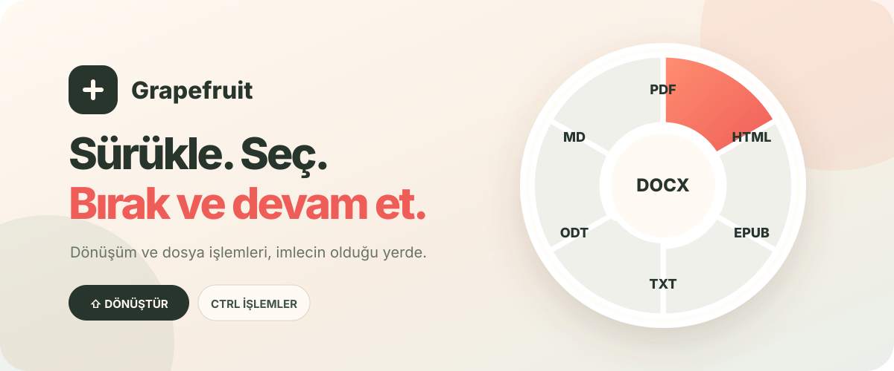

<div align="center">
  
  <h1>Grapefruit</h1>
  <p><strong>Dosyayı sürükle. Shift'e bas. Hedefe bırak.</strong></p>
  <p>Windows ve Linux için yerel, hızlı ve bağlama duyarlı dosya dönüştürücü.</p>

  [](https://github.com/EfeDogan/grapefruit/actions/workflows/windows.yml)
  [](https://efedogan.github.io/grapefruit/)
  
  
</div>

<br />

<picture>
  
</picture>

Grapefruit, dosya yöneticisindeki sürükle-bırak hareketini bölmeden imlecin yanında
dairesel bir menü açar. Varsayılan olarak `Shift` dönüşüm hedeflerini, `Control`
hızlı dosya işlemlerini gösterir; iki tuşun görevi uygulama veya GNOME uzantısı
ayarlarından değiştirilebilir. Dosyalar bir sunucuya yüklenmez; dönüşümler yerel
araçlarla bilgisayarda gerçekleştirilir.

> [Proje sayfasını aç →](https://efedogan.github.io/grapefruit/)

## Neler yapabiliyor?

| Aile | Desteklenen hedefler |
| --- | --- |
| Görsel | JPG, PNG, WebP, TIFF, AVIF, PDF |
| Video | MP4, MOV, MKV, WebM, AVI, GIF, MP3 |
| PDF | 300 DPI PNG/JPG, TXT, Markdown |
| Belge | PDF, DOCX, ODT, TXT, HTML, EPUB |
| Sunum | PDF, PPTX, ODP, PNG/JPG slaytları |

Dosya işlemleri menüsü yolu kopyalama, başka klasöre kopyalama veya taşıma,
dosyayı klasörde gösterme ve bulunduğu konumda terminal açma işlevlerini içerir.

## Nasıl çalışıyor?

1. Explorer veya GNOME Files'ta bir ya da birkaç dosyayı sürüklemeye başla.
2. Dönüştürme için `Shift`, dosya işlemleri için `Control` tuşuna bas.
3. İmlecin yanında açılan çemberde hedefin üzerine bırak.

Açık menüde `Shift` ve `Control` arasında geçiş yapılabilir. Menü ilk açıldığı
konumu korur ve ekran sınırlarının dışına taşmaz. Uygulamanın **Ayarlar**
penceresinden tuşlar yer değiştirilebilir. Menü yalnızca Explorer, GNOME Files
veya masaüstünden başlayan doğrulanmış bir dosya sürüklemesinde açılır; bağımsız
global klavye kısayolu kaydedilmez.

## Platform durumu

| Platform | Durum | Not |
| --- | --- | --- |
| GNOME / Wayland | Kullanılabilir | Gerçek dosya sürükleme, konumlandırma ve dönüşümler doğrulandı. |
| Linux / X11 | Kod hazır | Gerçek dosya yöneticisi kabul testi bekliyor. |
| Windows 10/11 | Preview | Masaüstü Shell seçimi ve yalnızca dosya sürüklerken çalışan Shift/Ctrl akışı yenilendi; v0.3.4 kabul testi bekliyor. |

Windows kabul adımları [docs/WINDOWS_TESTING.md](docs/WINDOWS_TESTING.md)
dosyasındadır. Windows izleyicisi yalnızca masaüstü veya Explorer kaynaklı,
yerel dosya seçimi doğrulanmış sürüklemeleri kabul eder.

## Yerel geliştirme

Gereksinimler:

- Rust stable
- Node.js 22 ve pnpm 10
- Linux için FFmpeg, Poppler ve LibreOffice
- Tauri'nin platform bağımlılıkları

```bash
pnpm --dir apps/desktop install
cargo test --workspace
pnpm --dir apps/desktop tauri dev
```

Komut satırı prototipi:

```bash
cargo run -p file-formatter-cli -- doctor
cargo run -p file-formatter-cli -- capabilities rapor.docx sunum.pptx
cargo run -p file-formatter-cli -- convert --to pdf rapor.docx
```

### Hazır kurulum paketleri

Hazır preview paketleri:

- [Windows x64 `.exe`](https://github.com/EfeDogan/grapefruit/releases/download/v0.3.3/Grapefruit_0.3.3_x64-setup.exe)
- [Ubuntu/Debian amd64 `.deb`](https://github.com/EfeDogan/grapefruit/releases/download/v0.3.3/Grapefruit_0.3.3_amd64.deb)
- [Sürüm notları ve SHA-256 değerleri](https://github.com/EfeDogan/grapefruit/releases/tag/v0.3.3)

Linux paketi GNOME Shell ve Nautilus bütünleştirme dosyalarını sistem genelinde
kurar. Paket, eski File Formatter uzantısını Grapefruit entegrasyonuna taşır ve
uygulamayı pencere açık kalmadan sistem tepsisinde çalıştırır.

Windows paketini yerelde üretmek için:

PowerShell 7 üzerinden sabit sürümlü ve SHA-256 doğrulamalı FFmpeg/Poppler
araçlarını hazırlayıp NSIS paketi oluşturabilirsin:

```powershell
./scripts/fetch-windows-tools.ps1
pnpm --dir apps/desktop install --frozen-lockfile
pnpm --dir apps/desktop tauri build --bundles nsis
```

FFmpeg ve Poppler Windows paketine dahil edilir. Belge ve sunum dönüşümleri için
LibreOffice'in Windows'ta ayrıca kurulu olması gerekir.

### Farklı araç yolları

İç değişken adları geriye dönük uyumluluk için korunur:

```bash
FILE_FORMATTER_LIBREOFFICE=/özel/yol/soffice
FILE_FORMATTER_FFMPEG=/özel/yol/ffmpeg
FILE_FORMATTER_PDFTOPPM=/özel/yol/pdftoppm
FILE_FORMATTER_PDFTOTEXT=/özel/yol/pdftotext
```

## Mimari

```text
apps/desktop/                 Tauri masaüstü uygulaması ve dairesel arayüz
crates/file-formatter-core/   Dönüşüm planı, araç adaptörleri ve dosya güvenliği
crates/file-formatter-cli/    Çekirdeğin komut satırı prototipi
integrations/                 GNOME Shell ve Nautilus bütünleşmesi
website/                      GitHub Pages tanıtım sayfası
```

Platform kararları için [docs/PLATFORM_INTEGRATION.md](docs/PLATFORM_INTEGRATION.md),
planlanan işler için [docs/ROADMAP.md](docs/ROADMAP.md) dosyasına bakın.

## Veri güvenliği

- Kaynak dosyalar değiştirilmez.
- Var olan çıktıların üzerine yazılmaz; çakışmada yeni ad üretilir.
- Komutlar kabuk metnine dönüştürülmez, araçlara ayrı süreç argümanı olarak verilir.
- Geçici çıktılar sistem geçici dizininde hazırlanır; yalnızca tamamlanan dosya hedefe taşınır.
- Bir klasörün kendi içine kopyalanması veya taşınması reddedilir.
- Her LibreOffice işi yalıtılmış kullanıcı profili kullanır.

## Testler

```bash
cargo fmt --all --check
cargo test --workspace
cargo clippy --workspace --all-targets -- -D warnings
pnpm --dir apps/desktop build
```

## Lisans notu

Projenin kendi lisansı henüz seçilmedi. Windows paketindeki FFmpeg, Poppler ve
diğer üçüncü taraf bileşenlerin bildirimleri
[`THIRD_PARTY_NOTICES.txt`](apps/desktop/src-tauri/windows-tools/THIRD_PARTY_NOTICES.txt)
dosyasında tutulur. Herkese açık bir son kullanıcı sürümü yayımlanmadan önce
dağıtım yükümlülükleri ayrıca gözden geçirilmelidir.
